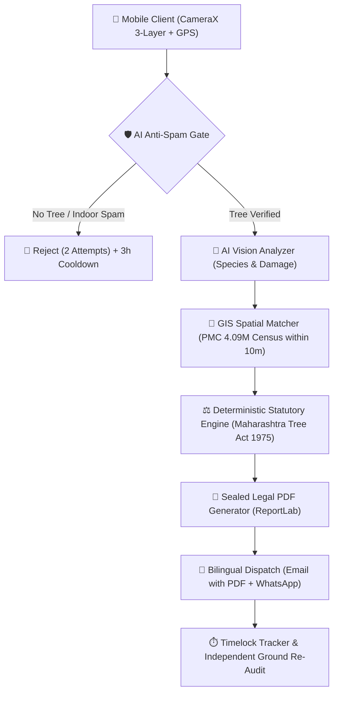

# 🌳 Pune Tree Rakshak (Citizen Complaint App)
> **iQOO Hackathon 2026 — Pune City Battle (Open Innovation Track)**

A phone-first civic accountability and tree preservation platform empowering Pune citizens to document, legally ground, dispatch, and independently verify tree emergencies and environmental violations under the **Maharashtra (Urban Areas) Protection & Preservation of Trees Act, 1975**.

---

## 🌟 Key Innovations & Technical Highlights

1. **7-Category Statutory Civic Taxonomy**:
   * Covers all major urban tree violations: Leaning Trees, Illegal Felling & Sabotage, Heavy Pruning, Hazardous Branches, Root Concretization, Disease/Pest, and Tree Vandalism (Nails/Banners/Cables).
2. **3-Layer Forensic Evidence Standard (Locus $\rightarrow$ Structure $\rightarrow$ Detail)**:
   * Dynamically guides citizens through 3 standardized angles:
     * **Layer 1 (Locus Context)**: Wide shot of tree and street setting (eliminates "not from this street" municipal pushback).
     * **Layer 2 (Structural Frame)**: Mid-range frame connecting the issue to the tree's main architecture (lean vector, severed limbs, trunk clutter).
     * **Layer 3 (Forensic Macro)**: Close-up evidence of the exact violation (fresh chainsaw tooth marks, iron nails in cambium bark, cracked limb joint, choked root collar).
3. **AI Anti-Spam Gate & Quota Protection**:
   * Computer vision verifies genuine tree presence before processing, rejecting non-tree/indoor photos with a strict 3-attempt quota and a 3-hour cooldown to protect civic and AI resources.
4. **Government GIS Tree Census Integration (4.09M Trees)**:
   * Spatially queries Pune Municipal Corporation's official 4.09-Million Tree Census GIS dataset within a 10-meter radius to attach the government-verified Census Tree ID, botanical name, and girth record.
5. **Deterministic Legal Routing Engine**:
   * Replaces hallucination-prone black-box LLMs with an explainable statutory engine encoding the Maharashtra Tree Act, 1975:
     * **Active Cutting** $\rightarrow$ Pune Police (112) + Tree Officer (Section 21 cognizable offense).
     * **Stumps / Sabotage** $\rightarrow$ PMC Tree Authority (Ghole Road) + Local Police Station (FIR trail).
     * **Tree Vandalism (Nails/Wires)** $\rightarrow$ PMC Garden Department (Tree Ambulance) + Ward Encroachment.
     * **Root Concretization** $\rightarrow$ PMC Road Department & Ward Tree Officer (NGT 1-meter basin mandate).
     * **Leaning Hazards** $\rightarrow$ PMC Disaster Management Cell & Ward Tree Officer.
6. **Sealed Statutory PDF & Bilingual Dispatch**:
   * Automatically compiles timestamped, tamper-evident PDF evidence documents complete with GPS coordinates, photos, and legal citations.
   * Generates formal English email (with attached PDF) + Marathi summary for WhatsApp dispatch.
7. **Zero-Trust Timelock Re-Audit & Escalation**:
   * Replaces fake municipal ticket closures with an independent citizen re-photography timelock (24h to 72h) and one-tap escalation to the Municipal Commissioner if unresolved.
8. **Hybrid Edge-to-Cloud AI Architecture**:
   * On-device NPU/GPU execution (via Google MediaPipe / LiteRT) for instant, offline, zero-cost analysis on flagship hardware like **iQOO 15**, backed by cloud vision AI (**Google Gemini 3.6 Flash**) for universal accessibility.

---

## 🏗️ Architecture



---

## 📋 The 7 Statutory Categories & Photo Guidance

| # | Category | Core Focus | 3-Layer Photo Sequence | Primary Authority |
|---|---|---|---|---|
| 1 | `DANGEROUS_LEANING_FALL_RISK` | Uprooting, tilt hazard | Wide street $\rightarrow$ Trunk angle $\rightarrow$ Root plate heave | PMC Disaster Cell & Ward Tree Officer |
| 2 | `ILLEGAL_FELLING` | Severing, chopping, poisoning | Avenue gap $\rightarrow$ Felled timber $\rightarrow$ Sawn stump/base | Active: Police 112 + Tree Officer<br>Stump: Tree Authority (Ghole Rd) |
| 3 | `UNAUTHORIZED_PRUNING` | Canopy decapitation | Ruined crown $\rightarrow$ Scaffold cuts $\rightarrow$ Severed branch stubs | PMC Tree Authority (Ghole Road) |
| 4 | `HAZARDOUS_BRANCH` | Snapped hanging limbs | Traffic clearance $\rightarrow$ Limb joint $\rightarrow$ Fracture split | Ward Tree Officer (Garden Dept) |
| 5 | `ROOT_CONCRETIZATION` | Suffocated root collar | Footpath setting $\rightarrow$ Paving extent $\rightarrow$ Concrete touching bark | PMC Road Dept & Ward Tree Officer |
| 6 | `DISEASE_PEST` | Rot, cavities, termites | Canopy vigour $\rightarrow$ Affected trunk $\rightarrow$ Fungal conk / termite mud | Ward Tree Officer & Tree Authority |
| 7 | `NAILS_BOARDS_CABLE_STRANGULATION` | Cambium strangulation | Street defacement $\rightarrow$ Trunk clutter $\rightarrow$ Nails/cables in bark | PMC Garden Dept (Tree Ambulance) |

---

## ⚖️ Statutory Legal Grounding
* **Section 2(c)**: *"to fell a tree" includes burning or cutting or in any way damaging a tree.*
* **Section 7(b)**: Duty to remove dangerous or leaning trees to protect human life and property.
* **Section 8(1)**: Absolute statutory prohibition on felling, lopping, or girdling without Tree Authority sanction.
* **Section 21**: Cognizable criminal offence punishable with fine and imprisonment; mandatory police intervention for in-progress felling.
* **NGT Principal Bench Directives**: Mandatory 1-meter unpaved green basin around all urban tree bases.
* **High Court of Bombay Orders**: Hammering iron nails, driving screws, and fixing commercial boards on trees is a punishable offense.

---

## 🚀 Getting Started

### 1. Backend Service (FastAPI)

```bash
cd backend

# Create virtual environment & install dependencies
python -m venv venv
source venv/bin/activate # or venv\Scripts\activate on Windows
pip install -r requirements.txt

# Start backend server
uvicorn app.main:app --reload --host 0.0.0.0 --port 8000
```

* Swagger API Documentation: `http://localhost:8000/docs`

### 2. Android App (Kotlin + Jetpack Compose)

```bash
cd android
# Build debug APK
./gradlew assembleDebug
```
